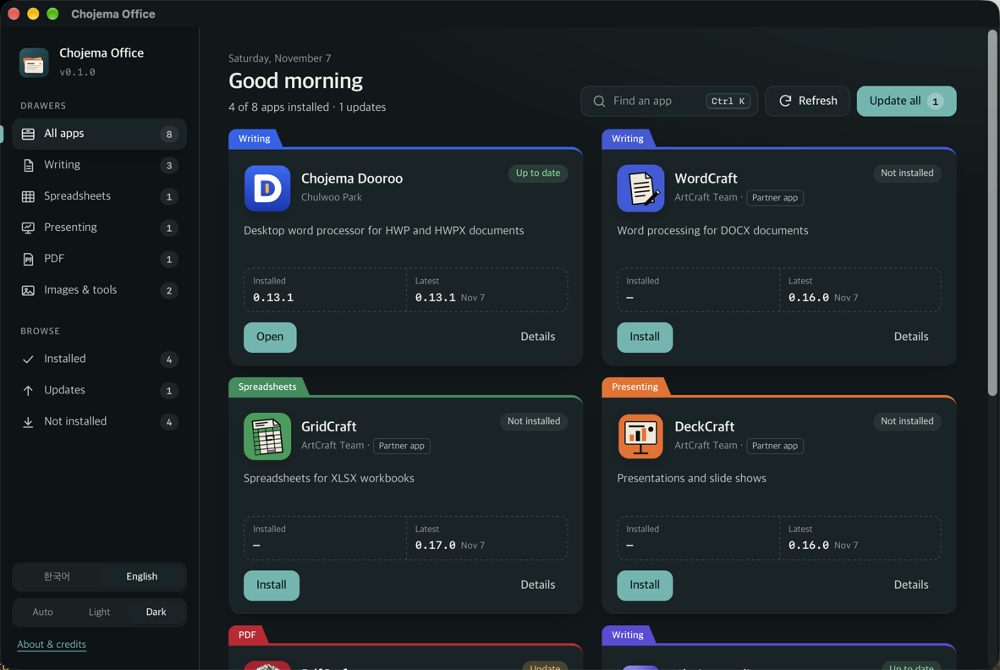
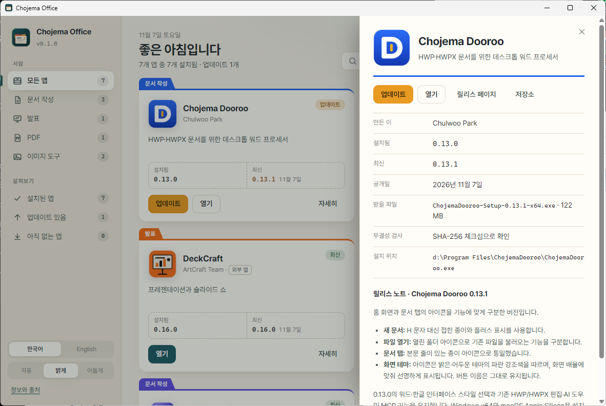
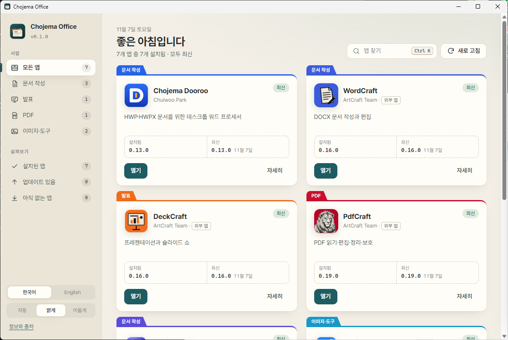

<p align="center">
  
</p>

<h1 align="center">Chojema Office</h1>

<p align="center">
  <b>Install, update and open your writing, spreadsheet, presentation, PDF and image apps from one window.</b><br>
  Chojema Dooroo · WordCraft · GridCraft · DeckCraft · PdfCraft · Chojema PDFLock · Chojema Editor · Chojema Image+ · Chojema KeyStamp
</p>

<p align="center">
  <a href="https://github.com/chojema/chojema-office/releases/latest"></a>
  
  
  <a href="https://github.com/chojema/chojema-office/actions/workflows/ci.yml"></a>
</p>

<p align="center">
  <a href="README.md">한국어</a> · <b>English</b>
  &nbsp;|&nbsp;
  <a href="https://github.com/chojema/chojema-office/releases/latest"><b>Download</b></a> ·
  <a href="#the-apps">The apps</a> ·
  <a href="#features">Features</a> ·
  <a href="#build-from-source">Build</a>
</p>

<p align="center">
  
</p>

## What it does

No more hunting through eight release pages. Chojema Office gathers eight office apps in one place: it shows which
ones you have and which version, installs the right build for your computer, and tells you when an update is out.

## The apps

| Category | Name | Purpose | Author |
|---|---|---|---|
| Writing | [Chojema Dooroo](https://github.com/chojema/ChojemaDooroo) | Desktop word processor for HWP and HWPX documents | Chulwoo Park |
| Writing | [WordCraft](https://github.com/storytold/wordcraft) | Word processing for DOCX documents | ArtCraft Team (partner app) |
| Writing | [Chojema Editor](https://github.com/chojema/chojema-editor) | Text editor with WYSIWYG editing for Markdown, HTML and more | Chulwoo Park |
| Spreadsheets | [GridCraft](https://github.com/storytold/gridcraft) | Spreadsheets for XLSX workbooks | ArtCraft Team (partner app) |
| Presenting | [DeckCraft](https://github.com/storytold/deckcraft) | PPTX presentations and slide shows | ArtCraft Team (partner app) |
| PDF | [PdfCraft](https://github.com/storytold/pdfcraft) | Read, edit, organize and protect PDFs | ArtCraft Team (partner app) |
| PDF | [Chojema PDFLock](https://github.com/chojema/chojema-pdflock) | Set open and permissions passwords for PDFs (Windows available, macOS coming soon) | Chulwoo Park |
| Images & tools | [Chojema Image+](https://github.com/chojema/ChojemaImagePlus) | Lightweight, fast image viewer | Chulwoo Park |
| Images & tools | [Chojema KeyStamp](https://github.com/chojema/chojema-keystamp) | Create keycap images and animations | Chulwoo Park |

**Partner apps** are open-source apps by other developers. Chojema Office does not redistribute them; on request it
downloads each app's official installer, unchanged, from that app's GitHub releases. Full credits are in [ATTRIBUTION.md](ATTRIBUTION.md).

## Features

<table>
  <tr>
    <td width="33%" valign="top">
      <h3>🗂️ Organized in drawers</h3>
      Browse by drawer (Writing, Spreadsheets, Presenting, PDF, Images & tools) or by state (Installed, Updates, Not installed). Each folder card shows the installed and latest version side by side.
    </td>
    <td width="33%" valign="top">
      <h3>⬇️ Verified installs</h3>
      Picks the installer for your OS and CPU (MSI, NSIS, DMG), checks it against the release's SHA-256 checksum when one is published, then installs it. "Update all" does every update in one go.
    </td>
    <td width="33%" valign="top">
      <h3>⌨️ Ctrl K quick launch</h3>
      Type an app's name or what it does to open or install it. The details panel shows release notes, the file to download and where the app is installed.
    </td>
  </tr>
</table>

<p align="center">
  
  
</p>

- Interface in Korean (default) and English. It follows the system language; switch it at the bottom left.
- Theme: Auto (follows the system), Light or Dark.
- Open at sign-in: a switch at the bottom left (off by default).
- About & links: the GitHub repository, Chojema App Park, and channels (blog, YouTube, X, Instagram, GitHub, homepage).
- App versions come from the public GitHub API, with an ETag cache to stay under the rate limit; offline, the last
  known information is shown. If you hit the limit, set `CHOJEMA_OFFICE_GITHUB_TOKEN` to a GitHub token.
- When a new Chojema Office is out, a banner offers to download and install it.
- Nothing is sent anywhere beyond the release lookups and installer downloads.

## Downloads

Get the file for your computer from the [latest release](https://github.com/chojema/chojema-office/releases/latest). `<ver>` is the version number.

| System | File | Notes |
|---|---|---|
| Windows 10 and 11 (x64) | `ChojemaOffice-<ver>-windows-x64-setup.exe` | Installs for the current user, no admin rights needed |
| macOS 11 or later | `ChojemaOffice-<ver>-macos-universal.dmg` | Apple silicon and Intel. Drag it to Applications |

Every release has a `SHA256SUMS.txt` to check the files against.

> [!NOTE]
> The installers are not code-signed yet. On Windows, if SmartScreen warns, choose **More info → Run anyway**. On macOS,
> if the app won't open, Control-click it in Finder and choose **Open**.

### Where apps are installed

Chojema Office runs each app's official installer unchanged, so the result is the same as installing by hand (and apps
you installed yourself are found too).

| System | How |
|---|---|
| Windows | MSI packages through Windows Installer (`msiexec /passive`), NSIS installers unattended (`/S`). Windows asks for permission when an app needs administrator rights |
| macOS | Mounts the DMG and copies the `.app` to `/Applications` (or `~/Applications` when that is not writable) |

## Build from source

You need [Rust](https://rustup.rs) 1.80 or newer and [Node.js](https://nodejs.org) 20 or newer; on Windows, WebView2
(included in Windows 11); on macOS, the Xcode Command Line Tools.

```sh
git clone https://github.com/chojema/chojema-office.git
cd chojema-office
npm install
npm run dev      # run in development mode
npm run build    # build installers (src-tauri/target/release/bundle/)
cd src-tauri && cargo test   # unit tests
```

Layout:

| Path | What |
|---|---|
| `src/` | Interface (HTML, CSS and JavaScript, no build step) |
| `src-tauri/src/catalog.rs` | The app list and how to detect each app |
| `src-tauri/src/github.rs` | GitHub release lookups and cache |
| `src-tauri/src/platform.rs` | OS and CPU, installer choice, version comparison |
| `src-tauri/src/detect.rs` | Finding installed apps and their versions |
| `src-tauri/src/install.rs` | Download, checksum, install and launch |

## License and credits

Chojema Office is licensed under the [Apache License 2.0](LICENSE).

- WordCraft, GridCraft, DeckCraft and PdfCraft are apps by the ArtCraft Team (MIT or Apache-2.0); their app icons are used unmodified from their repositories.
- Per-file credits: [ATTRIBUTION.md](ATTRIBUTION.md) · [NOTICE](NOTICE)
