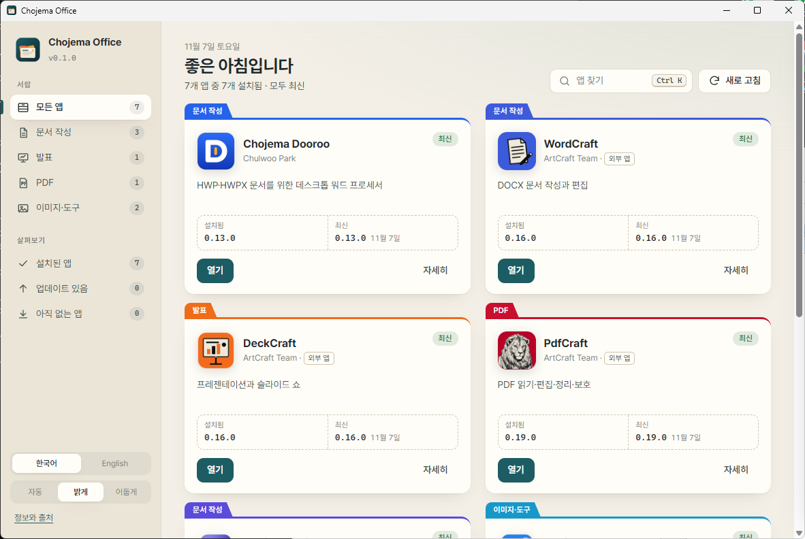
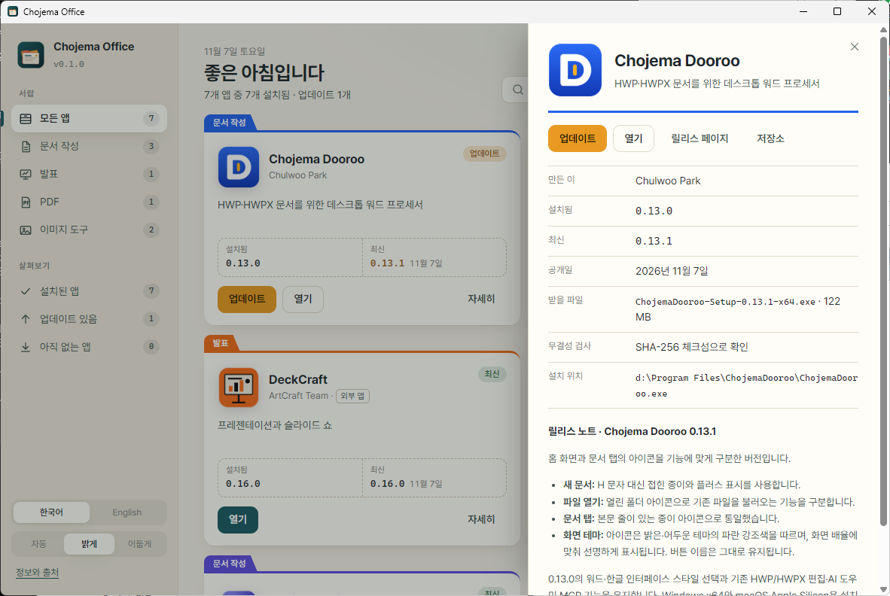
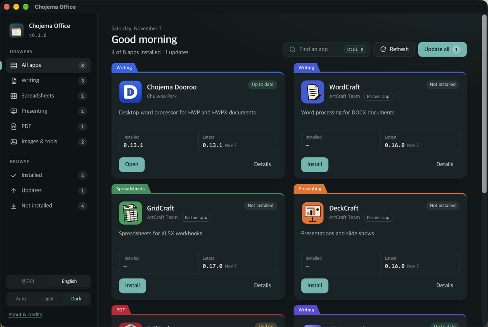

<p align="center">
  
</p>

<h1 align="center">Chojema Office</h1>

<p align="center">
  <b>문서 작성, 발표, PDF, 이미지 앱을 한 창에서 설치하고, 업데이트하고, 엽니다.</b><br>
  Chojema Dooroo · WordCraft · GridCraft · DeckCraft · PdfCraft · Chojema Editor · Chojema Image+ · Chojema KeyStamp
</p>

<p align="center">
  <a href="https://github.com/chojema/chojema-office/releases/latest"></a>
  
  
  <a href="https://github.com/chojema/chojema-office/actions/workflows/ci.yml"></a>
</p>

<p align="center">
  <b>한국어</b> · <a href="README.en.md">English</a>
  &nbsp;|&nbsp;
  <a href="https://github.com/chojema/chojema-office/releases/latest"><b>내려받기</b></a> ·
  <a href="#포함된-앱">포함된 앱</a> ·
  <a href="#기능">기능</a> ·
  <a href="#소스에서-빌드">빌드</a>
</p>

<p align="center">
  
</p>

## 무엇을 하나요

앱마다 따로 릴리스 페이지를 찾아다니지 않아도 됩니다. Chojema Office는 사무용 앱 여덟 가지를 한곳에 모아,
어떤 앱이 설치돼 있고 어떤 버전인지 보여 주고, 이 컴퓨터에 맞는 설치 파일을 골라 설치하며, 새 버전이 나오면 알려 줍니다.

## 포함된 앱

| 구분 | 이름 | 용도 | 작성 |
|---|---|---|---|
| 문서 작성 | [Chojema Dooroo](https://github.com/chojema/ChojemaDooroo) | HWP·HWPX 문서를 위한 데스크톱 워드 프로세서 | Chulwoo Park |
| 문서 작성 | [WordCraft](https://github.com/storytold/wordcraft) | DOCX 문서 작성과 편집 | ArtCraft Team(외부 앱) |
| 문서 작성 | [Chojema Editor](https://github.com/chojema/chojema-editor) | 마크다운, HTML 등의 위지윅 편집을 지원하는 텍스트 편집기 | Chulwoo Park |
| 스프레드시트 | [GridCraft](https://github.com/storytold/gridcraft) | XLSX 스프레드시트 작성과 계산 | ArtCraft Team(외부 앱) |
| 발표 | [DeckCraft](https://github.com/storytold/deckcraft) | PPTX 프레젠테이션과 슬라이드 쇼 | ArtCraft Team(외부 앱) |
| PDF | [PdfCraft](https://github.com/storytold/pdfcraft) | PDF 읽기·편집·정리·보호 | ArtCraft Team(외부 앱) |
| 이미지 도구 | [Chojema Image+](https://github.com/chojema/ChojemaImagePlus) | 가볍고 빠른 이미지 뷰어 | Chulwoo Park |
| 이미지 도구 | [Chojema KeyStamp](https://github.com/chojema/chojema-keystamp) | 키캡 이미지와 애니메이션 만들기 | Chulwoo Park |

**외부 앱**은 다른 개발자가 만든 오픈 소스 앱입니다. Chojema Office는 이 앱들을 함께 배포하지 않고,
사용자가 요청할 때 각 앱의 공식 GitHub 릴리스에서 설치 파일을 그대로 내려받습니다. 자세한 출처는 [ATTRIBUTION.md](ATTRIBUTION.md)에 있습니다.

## 기능

<table>
  <tr>
    <td width="33%" valign="top">
      <h3>🗂️ 서랍처럼 정리</h3>
      문서 작성·스프레드시트·발표·PDF·이미지 도구 서랍과 설치됨·업데이트·미설치 보기로 앱을 나눠 봅니다. 서류철 모양 카드에 설치 버전과 최신 버전이 나란히 나옵니다.
    </td>
    <td width="33%" valign="top">
      <h3>⬇️ 확인하고 설치</h3>
      운영 체제와 CPU에 맞는 설치 파일(MSI, NSIS, DMG)을 고르고, 릴리스에 SHA-256 체크섬이 있으면 대조한 뒤 설치합니다. 「모두 업데이트」로 한 번에 끝낼 수 있습니다.
    </td>
    <td width="33%" valign="top">
      <h3>⌨️ Ctrl K 빠른 실행</h3>
      앱 이름이나 하는 일을 입력하면 바로 열거나 설치합니다. 상세 패널에서는 릴리스 노트, 받을 파일, 설치 위치를 확인합니다.
    </td>
  </tr>
</table>

<p align="center">
  
  
</p>

- 화면 언어: 한국어(기본)와 영어. 시스템 언어를 따르고, 왼쪽 아래에서 바꿀 수 있습니다.
- 테마: 자동(시스템 설정), 밝게, 어둡게.
- 로그인할 때 자동 실행: 왼쪽 아래 스위치로 켜고 끕니다(기본은 꺼짐).
- 정보와 링크: GitHub 저장소, Chojema App Park, 채널(블로그·유튜브·X·인스타그램·GitHub·홈페이지)로 바로 갑니다.
- 앱 버전 정보는 GitHub 공개 API에서 가져옵니다. ETag 캐시를 써서 요청 한도를 아끼고, 연결이 안 되면 마지막으로 확인한 정보를 보여 줍니다.
  요청 한도가 부족하면 환경 변수 `CHOJEMA_OFFICE_GITHUB_TOKEN`에 GitHub 토큰을 넣을 수 있습니다.
- Chojema Office에 새 버전이 나오면 상단에 알림이 뜨고, 한 번에 내려받아 설치할 수 있습니다.
- 앱 정보 확인과 설치 파일 내려받기 말고는 어떤 정보도 외부로 보내지 않습니다.

## 내려받기

[최신 릴리스](https://github.com/chojema/chojema-office/releases/latest)에서 컴퓨터에 맞는 파일을 받으세요. `<ver>`는 버전 번호입니다.

| 시스템 | 파일 | 설명 |
|---|---|---|
| Windows 10·11 (x64) | `ChojemaOffice-<ver>-windows-x64-setup.exe` | 현재 사용자용 설치, 관리자 권한 불필요 |
| macOS 11 이상 | `ChojemaOffice-<ver>-macos-universal.dmg` | Apple 실리콘과 Intel Mac 공용. 응용 프로그램 폴더로 끌어다 놓으세요 |

릴리스마다 `SHA256SUMS.txt`가 있어 내려받은 파일을 확인할 수 있습니다.

> [!NOTE]
> 설치 파일에는 아직 코드 서명이 없습니다. Windows에서 SmartScreen 경고가 나오면 **추가 정보 → 실행**을,
> macOS에서 열리지 않으면 Finder에서 앱을 Control-클릭한 뒤 **열기**를 선택하세요.

### 앱이 설치되는 곳

Chojema Office는 각 앱의 공식 설치 파일을 그대로 실행하므로, 직접 설치한 것과 같은 결과가 됩니다(직접 설치한 앱도 찾아냅니다).

| 시스템 | 방법 |
|---|---|
| Windows | MSI는 Windows Installer(`msiexec /passive`), NSIS 설치 파일은 무인 설치(`/S`)로 실행합니다. 관리자 권한이 필요한 앱은 Windows가 권한을 묻습니다 |
| macOS | DMG를 연결해 `.app`을 `/Applications`(쓰기 권한이 없으면 `~/Applications`)에 복사합니다 |

## 소스에서 빌드

필요한 것: [Rust](https://rustup.rs) 1.80 이상, [Node.js](https://nodejs.org) 20 이상, Windows에서는 WebView2(Windows 11에 기본 포함),
macOS에서는 Xcode Command Line Tools.

```sh
git clone https://github.com/chojema/chojema-office.git
cd chojema-office
npm install
npm run dev      # 개발 모드로 실행
npm run build    # 설치 파일 만들기 (src-tauri/target/release/bundle/)
cd src-tauri && cargo test   # 단위 테스트
```

구성:

| 경로 | 내용 |
|---|---|
| `src/` | 화면(HTML·CSS·JavaScript, 빌드 도구 없음) |
| `src-tauri/src/catalog.rs` | 앱 목록과 설치 감지 정보 |
| `src-tauri/src/github.rs` | GitHub 릴리스 조회와 캐시 |
| `src-tauri/src/platform.rs` | 운영 체제·CPU 판별, 설치 파일 선택, 버전 비교 |
| `src-tauri/src/detect.rs` | 설치된 앱과 버전 찾기 |
| `src-tauri/src/install.rs` | 내려받기, 체크섬 확인, 설치, 실행 |

## 라이선스와 출처

Chojema Office는 [Apache License 2.0](LICENSE)으로 배포합니다.

- WordCraft, GridCraft, DeckCraft, PdfCraft는 ArtCraft Team의 앱(MIT 또는 Apache-2.0)이며, 앱 아이콘은 각 저장소의 파일을 수정 없이 사용합니다.
- 파일별 출처: [ATTRIBUTION.md](ATTRIBUTION.md) · [NOTICE](NOTICE)
